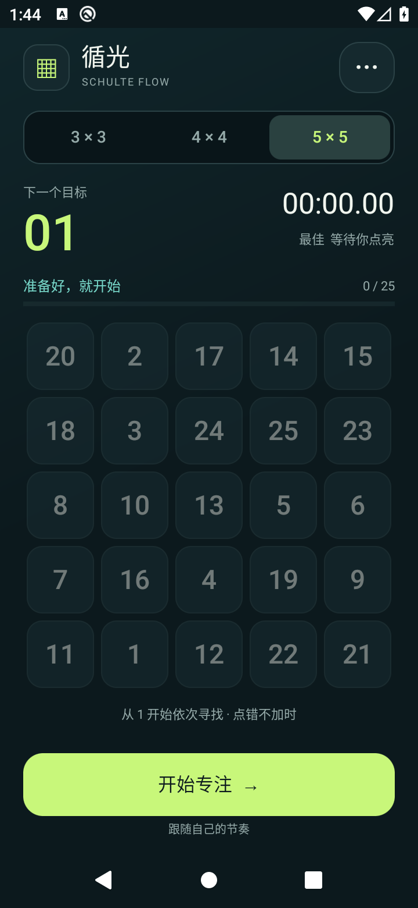

# 循光 · 舒尔特表 / Schulte Flow

离线运行的开源舒尔特表练习应用，提供原生 Android 和 Godot 数字球两种体验。无需账号，无广告，无统计；数据保存在本机。

| 版本 | 体验 | 安装要求 | 下载 |
| --- | --- | --- | --- |
| 原生 Java 1.0 | 轻量经典方格、点击回弹、连击、粒子和递进音效 | Android 8.0+ | [APK 与验证报告](https://github.com/azfiles/schulte-flow/releases/tag/native-v1.0.0) |
| Godot 2.0 | 漂流碰撞的数字球、9 个关卡、星级与进度恢复 | Android 7.0+ / OpenGL ES 3.0 | [APK 与验证报告](https://github.com/azfiles/schulte-flow/releases/tag/godot-v2.0.0) |

 

## 功能

- 3×3 / 4×4 / 5×5 随机棋盘，从 1 开始依次点亮数字。
- 点击回弹、粒子、连击、递进音阶和触感，可独立关闭声音与振动。
- 暂停隐藏数字、进入后台自动停表、恢复未完成进度。
- 本机保存各难度最佳成绩、准确率、误触和练习记录。
- Godot 版增加刚体碰撞、9 个解锁关卡、星级和通关庆祝。

## 开发与构建

原生版需要 JDK 17、Python 3、Android SDK 的 `platforms;android-35` 和 `build-tools;35.0.0`：

```bash
bash build.sh
mkdir -p build/model
javac -d build/model app/src/main/java/com/alex/schulteflow/GameSession.java tests/GameSessionTest.java
java -cp build/model GameSessionTest
```

Godot 版使用 Godot 4.6.3，直接导入 `godot/project.godot`；也可在 Linux 上运行：

```bash
bash scripts/godot/setup.sh
export GODOT="$PWD/build/godot-tools/bin/godot"
export XDG_DATA_HOME="$PWD/build/godot-tools/data"
bash scripts/godot/test.sh
bash scripts/godot/build.sh
```

原生包名 `com.alex.schulteflow`，Godot 包名 `com.alex.schulteflow.godot`，两者可并存，成绩互不迁移。仓库内为原有公开演示签名，保留其包名与证书以支持体验包覆盖安装。正式分发需自行保管生产签名。

## 验证与发布

普通提交运行规则与场景检查。完整 APK 编译、模拟器冒烟和发布由 Actions 手动触发，避免每次文档修改都启动模拟器。失败不会发布。

本仓库首批 Release 从 `azfiles/apkGo` 的已发布文件迁移，逐文件校验 SHA-256，保留原包、证书和验证记录；迁移不代表重新执行了设备测试。原生版历史验证为 92 项逻辑、169 项 Android UI 检查；Godot 版为 368 项逻辑、53 项场景、22 项 Android 检查。范围见 [原生验证](docs/verification.md)、[Godot 验证](docs/godot-verification.md)。

后续开发见 [贡献与扩展指南](CONTRIBUTING.md)。[迁移来源与文件摘要](docs/upstream-releases.json)。Unity 原型单独保存于 [schulte-flow-unity](https://github.com/azfiles/schulte-flow-unity)。

## 结构与许可

- `app/`、`tests/`、`build.sh`：原生 Android 版与设备冒烟。
- `godot/`、`scripts/godot/`：Godot 客户端与导出工具。
- `docs/`：界面截图、构建说明和验证记录。
- `.github/workflows/`：轻量检查、手动构建及已发布版本迁移。

项目自有代码采用 [MIT License](LICENSE)。字体、引擎及其依赖保留各自许可证，见 [NOTICE](NOTICE.md)。
